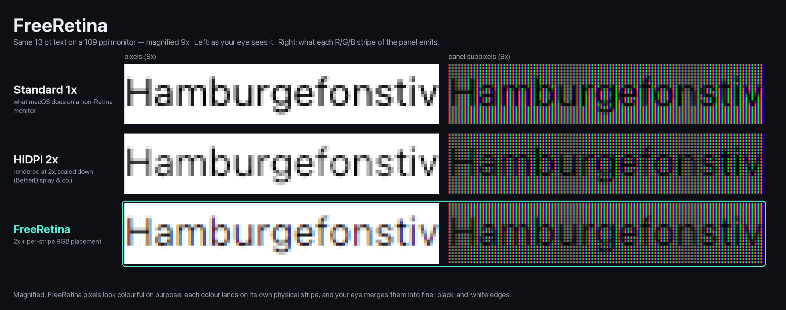
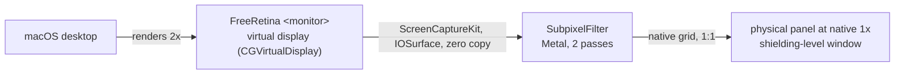

# FreeRetina

**Retina-like text on the monitor you already own.**

FreeRetina gives any external monitor a set of HiDPI resolutions that show up in System Settings › Displays. macOS renders the whole desktop at 2x, and FreeRetina maps every frame back onto the panel **one R, G and B stripe at a time**. A normal 1440p or ultrawide monitor gets crisp, Retina-style text, and it's tuned to your eyes by a 30-second blind test.



- 🖥️ **Shows up as a real display.** It's listed in System Settings with resolutions from 100 % down to 50 % of native, and you switch between them live.
- 🔬 **Subpixel rendering for the whole screen.** ClearType-style placement of luminance on each RGB stripe, in linear light, with a FreeType LCD filter to keep colour fringes down.
- 👁️ **Self-calibrating.** The assistant shows three variants pixel-exact on *your* panel (blind, in random order) and picks the stripe order, strength and size from your answers.
- 🖱️ **Low-latency pointer.** The cursor is drawn at its live position on every mouse move, not baked into captured frames.
- 🛟 **Paranoid about safety.** Every display change is undone by macOS the moment the engine process ends. There are watchdogs, a supervisor, confirm-or-revert and an emergency hotkey (⌃⌥⌘⎋).
- ⚡ **Cheap.** Zero-copy capture (IOSurface → Metal), two compute passes, about 5 % CPU on an M3 Max.

Apple Silicon (M1 or newer), macOS 14+. No kernel extensions, no SIP changes.

## Install

```
git clone https://github.com/redbasecap/FreeRetina.git && cd FreeRetina
scripts/build-app.sh                      # → build/FreeRetina.app
cp -R build/FreeRetina.app /Applications/ && open /Applications/FreeRetina.app
```

The build signs with your first "Apple Development" identity if you have one (or with `SIGN_IDENTITY`). Without one it signs ad-hoc, and then macOS asks for the Screen Recording permission again after every rebuild.

## Setup assistant

FreeRetina is a menu bar app. On first launch the setup assistant opens:

1. Pick the monitor. Preflight checks block unsupported cases (Intel Mac, built-in panel, rotated or mirrored monitor) and warn about panels that are already dense (≥ 180 ppi).
2. The monitor switches to native 1x just for the test, and three sample variants are shown **pixel-exact on that panel**, in random order as A/B/C:
   - Test 1: RGB vs BGR vs no stripe sharpening (finds the panel's subpixel order).
   - Test 2: strength 50 / 80 / 100 % (sharpness vs colour fringes).
   - Test 3: three "looks like" sizes at real size.
   - "Ich sehe keinen Unterschied" always picks the option without risk.
3. Activate → a 15 s confirm-or-revert dialog appears, drawn through the new pipeline. If the picture is broken, nobody can click "Behalten", and everything reverts.

Settings are stored in `~/Library/Application Support/FreeRetina/config.json` for each monitor (vendor-model-serial). Resolution changes made in System Settings are saved back to it. The app needs **Screen & System Audio Recording** permission, and the assistant asks for it.

## Safety

The app never changes displays itself. Each monitor gets its own engine process (`freeretina run --supervised`). Every display change that engine makes is app-only, so **macOS restores the original setup whenever the engine process ends, for whatever reason.** All the layers below therefore come down to "end the engine when in doubt":

| layer | catches |
|---|---|
| app-only display config + process-owned virtual display | crash, kill -9, normal exit |
| per-monitor flock + virtual-display serial check | two engines on one monitor |
| main-thread watchdog thread (8 s) | engine UI thread hangs |
| supervisor heartbeat (10 s) → SIGKILL | engine frozen as a whole |
| parent-death watch | app crashes or is killed |
| startup timeout: no first frame within 15 s | capture never delivers |
| unplug / mirror / foreign mode-change detection | monitor setup changes underneath |
| capture retry (3/min), crash-loop stop (3 in 2 min) | flapping capture, broken setups |
| confirm-or-revert after each new setup (15 s) | picture wrong or invisible |
| emergency hotkey ⌃⌥⌘⎋, works in every app | anything the user dislikes |

## CLI

```
freeretina displays                       # panels, native modes, offered resolutions, preflight
freeretina run                            # start (Ctrl-C restores everything)
freeretina run --looks 2752x1152 --order bgr --strength 0.8
freeretina compare --out compare          # offline before/after PNGs
```

## What happens



- **FreeRetina &lt;monitor&gt;** is a real display. It shows up in System Settings › Displays with these resolutions: 100 %, 93.75 %, **87.5 % (first-run default)**, 80 %, 75 %, 66.7 % and 50 % of native, all HiDPI. macOS remembers whichever one you pick, and FreeRetina follows changes live.
- The physical monitor switches to its native 1x mode, so every output pixel lands on exactly one panel pixel. It's moved to the right in the display arrangement, and the pointer can't go onto it.
- These arrangement changes use `kCGConfigureForAppOnly`, so macOS undoes them when the process exits, even after a crash or kill. The virtual display goes away at the same time.

## The algorithm

On an RGB-stripe LCD, each pixel is three separately addressable stripes. That gives 3x horizontal resolution for **luminance**, and that's what text edges are mostly made of. Per output pixel, in linear light:

1. Exact area filter vertically (pass 1).
2. Horizontally, area-sample the luminance in 7 stripe-wide slots: the pixel's own 3 stripes plus 2 on each side.
3. Run the FreeType LCD filter `[8, 77, 86, 77, 8]/256` across those slots for each stripe. This limits colour fringing.
4. `out_c = C_c + strength · (Lf_c − L_pixel)`. Colour (`C`) comes from the pixel's area average, and only luminance detail moves to stripe precision. For grey text this is exactly ClearType-style rendering. `strength 0` is a plain area downsample, which is the same as ordinary HiDPI scaling.

Measured against a 6x ground-truth render on a simulated RGB panel (`compare` test text, luminance RMSE after eye blur, lower is better):

| method | luminance error | colour error |
|---|---|---|
| native 1x (macOS default) | 0.051 | 0.013 |
| 2x HiDPI, area downsample | 0.031 | 0.007 |
| FreeRetina 2x, strength 1 | 0.028 | 0.052 |

Most of the improvement comes from supersampling. Stripe addressing adds roughly another 10 % horizontal sharpness, and the cost is faint colour fringes on glyph edges. Use `--strength` to pick the tradeoff.

## Limits (physics, not bugs)

- The panel still has a fixed number of pixels. Detail finer than one stripe horizontally, or one pixel vertically, can't be shown. Vertical edges get the benefit; horizontal edges don't.
- `--order` has to match the panel. Wrong order makes text look blurrier and more coloured. Check with a loupe, or try both settings.
- Screenshots and screen recordings show the 2x virtual display, not the subpixel output.
- Screen content gets about one to two frames of latency (capture → filter → present). Content-protected video (DRM) shows up black in capture.
- FreeRetina draws the mouse pointer itself, at its live position, and presents a new frame on every mouse movement (at most once per refresh). It doesn't wait for the next captured frame. Measured from mouse event to panel at 100 Hz: median 25 ms / p90 33 ms, down from 33.5 / 42.4 ms when the pointer came from the captured frames. A normal hardware cursor is still faster, because it bypasses compositing entirely.
- The pointer image comes from `NSCursor.currentSystem`, at the system's base size. The enlarged pointer from the Accessibility setting is untested.

## License

[PolyForm Noncommercial 1.0.0](LICENSE.md): free for personal and other noncommercial use. **Commercial use requires a paid license.** See [COMMERCIAL.md](COMMERCIAL.md).
